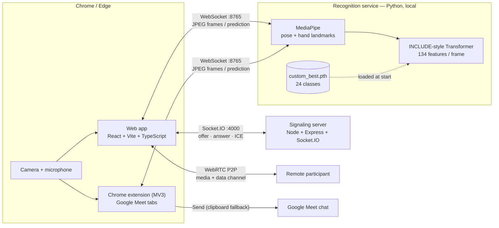
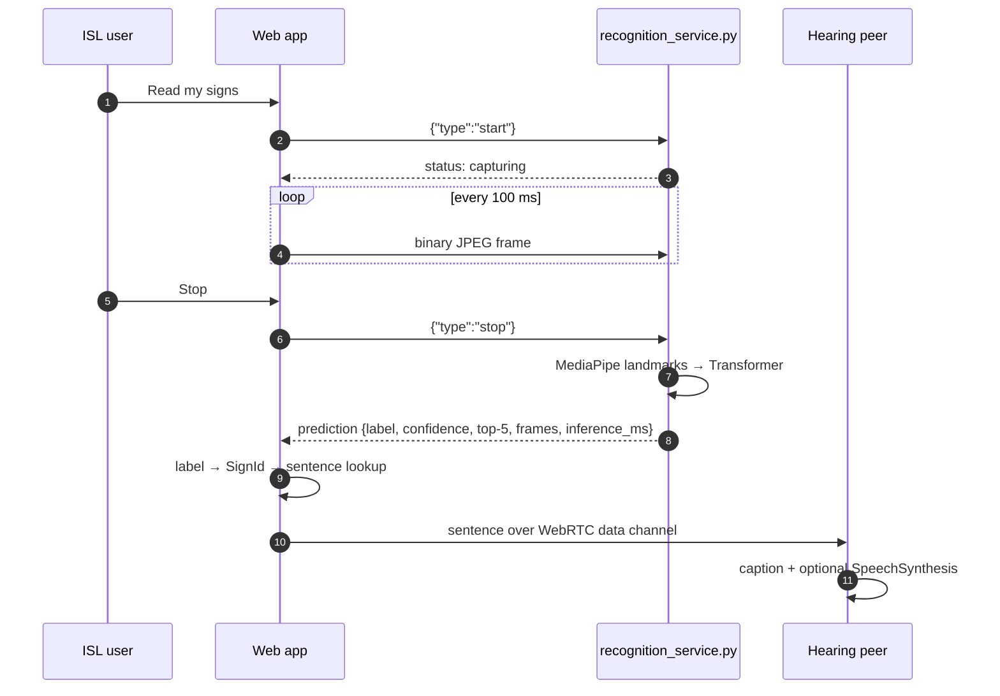
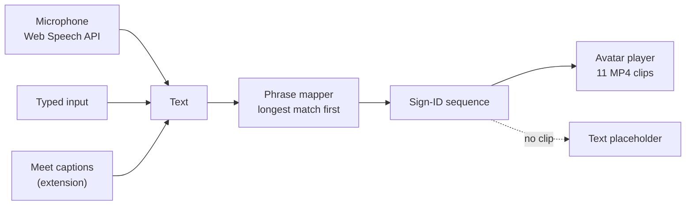
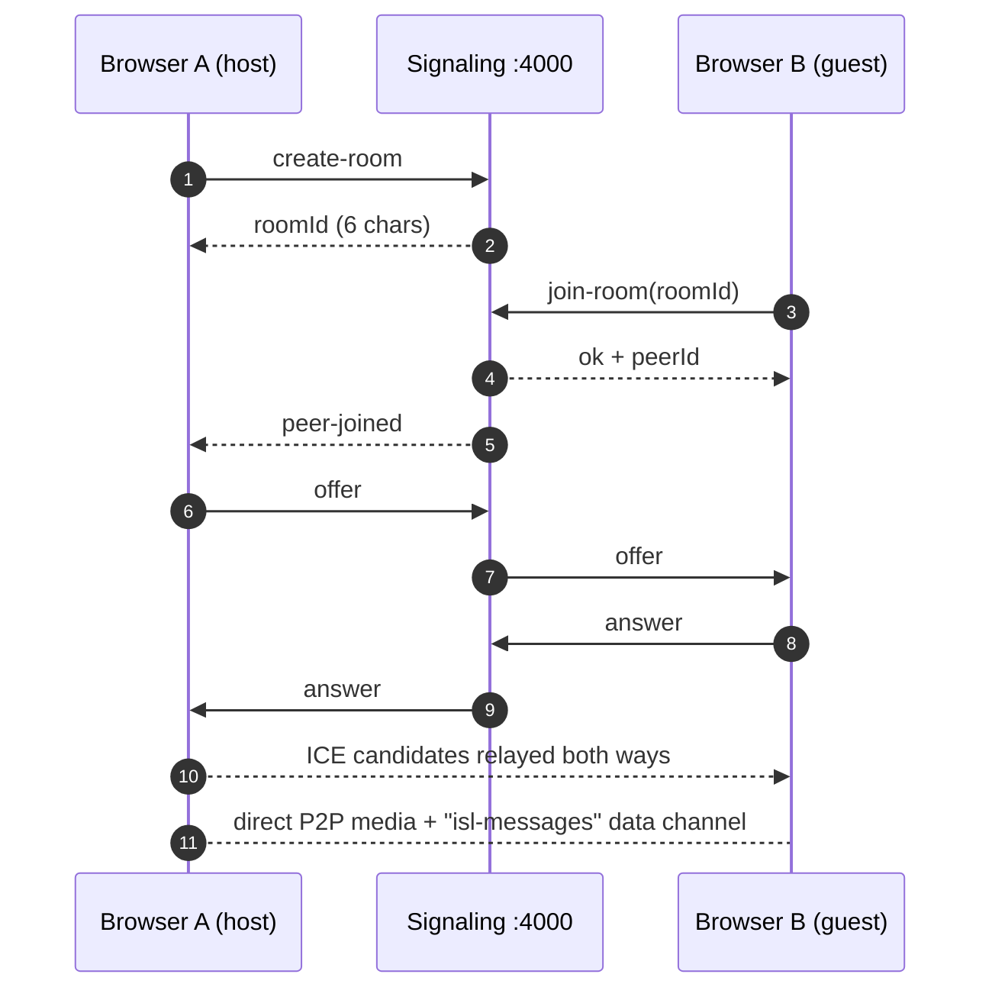
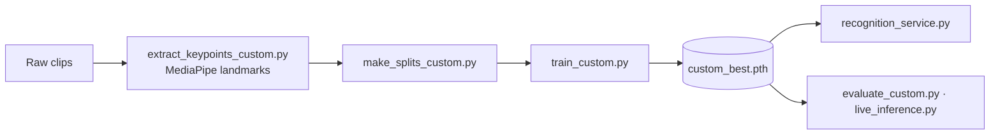
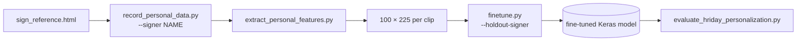

<div align="center">

# Samvaad · संवाद

### Two-way communication infrastructure for Indian Sign Language (ISL)

*Sign → Text → Speech, and Speech → Text → Sign — in a browser video call, in Google Meet, and soon in the classroom.*


</div>

---

## 1. Introduction

**Samvaad** (Hindi: *dialogue*) is a browser-based accessibility platform that connects Indian Sign Language users and hearing users. It combines a **WebRTC video call**, a **local landmark-based sign-recognition service**, **on-device browser speech APIs**, and a **sign-playback avatar layer**, so each person communicates in the way that is natural to them.

---

## 2. Problem and proposed solution

### The problem

- Deaf and hard-of-hearing ISL users are routinely excluded from video calls, healthcare visits, classrooms and service counters, where interpreters are scarce.
- Mainstream meeting tools caption *speech* but give a signer no way to be *understood* in return, and give hearing participants no way to *follow* a signer.
- Indian Sign Language has far fewer machine-readable resources than ASL, so off-the-shelf tooling rarely fits.

### The solution

Samvaad is a **bidirectional pipeline** built around a shared vocabulary of sign IDs (`WATER`, `HELP`, `THANK_YOU` …) used by recognition, phrase mapping and avatar playback.

| Direction | Pipeline |
|---|---|
| **ISL user → hearing user** | Webcam → JPEG frames → MediaPipe pose/hand landmarks → INCLUDE-style Transformer → sign label → sentence → caption + text-to-speech |
| **Hearing user → ISL user** | Microphone / typed text / Meet captions → transcript → phrase-to-sign mapper → sign avatar clip playback |

Inference runs **locally** (a Python WebSocket service on `127.0.0.1`), and call audio/video flows **peer-to-peer**; the signaling server never sees media.

---

## 3. Modules at a glance

| # | Module | Location | What it delivers |
|---|---|---|---|
| 1 | **Daily Translator** | `isl-comp-updated/isl-comp` | Live captions from signs, speech/typed replies, text-to-speech, two-person video call |
| 2 | **ISL Avatar** | web app, extension, `isl-connect/avatar` | Sign clip playback for speech→sign; Three.js FBX avatar renderer |
| 3 | **Meeting Companion** | `chrome-extension/` | Google Meet panel: sign→text chat, speech→sign avatar |
| 4 | **Learning Mode** | — | Lessons, demonstrations, quizzes, dictionary, camera practice (see [roadmap](#15-roadmap)) |

---

## 4. Module 1 — Daily Translator

A role-based **Communication Room** (`/room`) for face-to-face or remote conversation between an **ISL user** and a **hearing user**.

| Capability | Details | Source |
|---|---|---|
| Two-person WebRTC call | Create/join with a 6-character room code or invite link; offer/answer/ICE; rooms capped at two peers | `src/hooks/useVideoCall.ts`, `server/server.js` |
| Role-specific interfaces | ISL User gets **Read my signs**; Hearing User gets **Start listening**. Invite links carry the opposite role (`?role=isl` / `?role=hearing`) | `src/pages/CommunicationRoom.tsx` |
| Sign → caption | Frames from the camera stream go to the recognition service; the predicted sign becomes a sentence captioned on the peer's screen | `src/services/recognition.ts`, `CameraPanel.tsx` |
| Sentence builder | Deterministic lookup keyed on the sign sequence, with a label-stitching fallback | `src/data/signMappings.ts` |
| Text-to-speech | Browser `SpeechSynthesis` reads the ISL user's sentence aloud | `src/hooks/useTextToSpeech.ts` |
| Speech-to-text | Web Speech API, continuous with interim results, `en-IN` (Chromium) | `src/hooks/useSpeechRecognition.ts` |
| Typed responses | Keyboard input feeds the same phrase-mapping pipeline as speech | `ManualTextInput.tsx` |
| Speech/typed → signs | Longest-phrase-first mapper with aliases (e.g. "home" → `HOUSE`) | `src/utils/phraseMapper.ts` |
| Message transport | Finished sentences travel over a WebRTC **data channel** (`isl-messages`) | `useVideoCall.ts` |
| Call controls | Mic / camera / speaker toggles act on real media tracks; End Session tears the connection down | `CallControls.tsx` |
| Transcript & history | In-session conversation history and transcript drawer | `TranscriptDrawer.tsx` |
| Developer mode | Optional panel: detected sign, top-5 predictions, confidence, frame counts, inference time | `DebugPanel.tsx` |
| Landing & explainer pages | Home page and "How it works" | `src/pages/` |

End users see only the **final translated sentence**; raw sign tokens appear only in Developer mode. The camera and microphone are acquired once and shared by the call and the recognition client.

---

## 5. Module 2 — ISL Avatar

### 5.1 Sign clip avatar (web app and extension)

- `AvatarPanel.tsx` plays one muted `<video>` per sign ID in sequence, advancing on `onEnded`.
- Entry point: `useAvatarPlayer().playSigns(sequence)`, called after phrase mapping.
- **11 avatar clips:** `daughter`, `doctor`, `happy`, `hello`, `house`, `lawyer`, `parent`, `sad`, `student`, `train-station`, `waiter` (`isl-comp/public/avatar-videos/`, mirrored in `chrome-extension/assets/avatar/`).
- Swappable contract: `AvatarProps { signs: SignId[]; isPlaying?; onPlaybackComplete? }` (`src/types/index.ts`).

### 5.2 Three.js 3D avatar renderer (`isl-connect/avatar`, `isl-connect/frontend`)

- **Renderer:** Three.js `WebGLRenderer` + `AnimationMixer` (`AvatarViewer.jsx`); the model is auto-centred and grounded from its bounding box.
- **Character:** rigged 3D humanoid model, animated through FBX clips.
- **Animation assets:** 9 FBX clips — `idle`, `hello`, `thankyou`, `help`, `water`, `yes`, `no`, `sorry`, `attack`.
- **Workflow:** gloss list → `SIGN_MAP` → `window.playSigns([...])` loads each FBX with `FBXLoader`, plays it through the mixer, then returns to `idle`.
- **Demo harness:** `isl-connect/frontend` hosts the viewer with quick-phrase buttons, queue tests, caption overlay and transcript panel.

### 5.3 Video-to-avatar motion preservation — Future scope

Converting a signing video into avatar motion (landmark → skeletal retargeting) is planned. The MediaPipe landmark extraction already used in `include-ml` is the intended starting point. See the [roadmap](#15-roadmap).

---

## 6. Module 3 — Meeting Companion (Chrome extension)

A **Manifest V3** extension (`chrome-extension/`, v0.2.0, Chrome ≥ 116, no build step) that adds a Samvaad panel to **Google Meet**. The panel runs inside an extension iframe, so Meet's page CSP cannot block the camera or WebSocket.

| Capability | Details |
|---|---|
| **Sign → Text** | Camera frames stream to the same local recognition service as the web app; top-3 predictions with confidences appear as **editable text** |
| **Review-before-send** | Nothing is sent until the user presses **Send**. The extension fills Meet's chat box and sends; the clipboard is the fallback |
| **Sign verification** | Signs are enabled per user in Options; optional minimum-confidence and top-1/top-2 margin filters use real softmax output |
| **Speech → Sign** | Inputs: Meet live captions (read from the page; meeting audio is not recorded), the user's microphone (on-device Web Speech by default), or typed text |
| **Caption settling** | `CaptionTracker` waits for text to stabilise (1.5 s; 0.7 s after sentence-final punctuation) before signing |
| **Sign mapper** | Longest-phrase-first table (`config/avatar-signs.json`, 63 phrases); words that can't be signed are reported to the reader |
| **Avatar playback** | The 11 sign clips from §5.1; other mapped signs appear as text cards |
| **Resilience** | Reconnect with exponential back-off, frame dropping under back-pressure, mirror auto-detection from the checkpoint |
| **Privacy** | Transcripts kept only in panel memory; camera and socket released on stop or on leaving the meeting |
| **Extensible** | Platform adapter registry (`src/content/platforms/registry.js`) for adding further meeting platforms |
| **Automated tests** | Node unit tests, syntax/manifest check, Playwright fake-Meet end-to-end test, Python protocol check |

Quick-reply messages, an expanded in-meeting avatar and Zoom support are on the [roadmap](#15-roadmap).

---

## 7. Module 4 — Learning Mode

Learning Mode is the next product direction: an ISL learning space for both signers and hearing learners.

**Vision**

- **Lessons** organised around the shared sign vocabulary.
- **Sign demonstrations** using the avatar clip library and the 3D renderer.
- **Quizzes** to reinforce recall.
- **Sign dictionary** keyed on the shared sign-ID system.
- **Camera-based practice** using the live recognition service to check an attempted sign.

**Foundations already in the repository**

| Learning feature | Existing building block |
|---|---|
| Demonstrations | 11 avatar MP4 clips, 9 FBX animations, `AvatarPanel` |
| Dictionary | 24-sign vocabulary (`shared/vocabulary_real.json`), label/ID system, `recognition-ml/sign_reference.html` |
| Practice | Recognition service + `recognition.ts` client returning label, top-5 and confidence |

---

## 8. System architecture



**Design principles**

- **Local-first inference** — the service binds to `127.0.0.1`; frames stay on the machine.
- **Media never touches the server** — signaling relays only room membership, SDP and ICE.
- **One recognition service, two clients** — web app and extension share one WebSocket protocol.
- **Deterministic mapping layers** — sentence building and phrase→sign mapping are lookup tables: predictable and testable.
- **Shared sign-ID vocabulary** (`SCREAMING_SNAKE_CASE`) connects recognition, mapping and avatar playback.

---

## 9. Data flows and workflows

### 9.1 Sign → Speech



Service rules (`recognition_service.py`): minimum 8 frames, maximum 256 (auto-finishes), invalid JPEGs return an `error` message, and the service starts only with the 24-class / 134-feature checkpoint.

### 9.2 Speech → Sign



### 9.3 Call setup (WebRTC)



Room codes avoid the ambiguous characters `0/O/1/I`; STUN uses Google's public servers.

---

## 10. Recognition model and ML pipelines

### Pipeline A — `isl-connect/include-ml` (PyTorch, live recognition)



- **Model:** `DeterministicEvalTransformer`, a subclass of the Transformer from AI4Bharat's **INCLUDE** codebase (vendored in `include-ml/INCLUDE-master/`, built on Hugging Face `transformers`). It makes dropout apply only in training mode and masks padded frames before max-pooling; state dicts stay interchangeable with the original class.
- **Features:** 134 per frame = 25 pose landmarks × 2 + 21 landmarks × 2 coordinates × 2 hands; clips up to 256 frames.
- **Training defaults:** `small` size, 200 epochs, batch 16, lr 1e-4, weight decay 0.01, early-stopping patience 30, augmentation on.
- **Tooling:** per-class evaluation with confusion matrix, padding-mask unit test, offline video inference, live webcam inference.

**Recognised vocabulary (24 signs):** Beautiful, Bird, Daughter, Doctor, Dog, Father, Hello, House, I, Lawyer, Mother, Parent, Restaurant, Son, Student, Teacher, Thank you, Train Station, Waiter, Happy, He, Sad, She, You.

### Pipeline B — `isl-connect/recognition-ml` (TensorFlow/Keras personalisation)



LSTM(128) → LSTM(64) → Dense(64) → Dropout(0.3) → softmax. Supports per-signer recording and **signer-hold-out** fine-tuning (20 epochs, batch 8, lr 1e-4, patience 6, optional `--freeze-base-layers`) to study generalisation to unseen signers.

### Pipeline C — `isl-connect/nlp-sentence-model` (sentence generation)

A FastAPI service (`POST /convert`: `{"signs":[…]}` → `{"text","lang"}`) backed by a `t5-small` seq2seq model fine-tuned on a synthetic gloss→sentence dataset (`generate_synthetic_data_v3.py`). The apps currently use the deterministic sentence table.

---

## 11. Technology stack

| Layer | Technologies |
|---|---|
| **Web frontend** | React 18.3, TypeScript 5.6, Vite 5.4, React Router 6, Tailwind CSS 3.4, `lucide-react` |
| **Realtime** | WebRTC (`RTCPeerConnection`, data channel), `socket.io-client` 4.8 |
| **Signaling server** | Node.js (ES modules), Express 4, Socket.IO 4.8, CORS |
| **Browser speech** | Web Speech API (`SpeechRecognition`, `en-IN`), `SpeechSynthesis` |
| **Recognition service** | Python 3.12, PyTorch, Hugging Face `transformers` 4.44.2, MediaPipe 0.10.14, `websockets`, `timm`, `scikit-learn`, `xgboost` |
| **Personalisation** | TensorFlow/Keras, MediaPipe, OpenCV, NumPy, scikit-learn, Matplotlib |
| **Sentence model** | FastAPI, Uvicorn, T5 (`transformers`), PyTorch, pandas, SentencePiece |
| **3D avatar** | Three.js (`FBXLoader`, `AnimationMixer`), React, Vite, Tailwind |
| **Extension** | Chrome Manifest V3, plain JavaScript, service worker, content scripts, `playwright-core` |

---

## 12. Repository structure

```text
Samvaad/
├── isl-comp-updated/
│   └── isl-comp/                     # Main web app (Daily Translator)
│       ├── src/
│       │   ├── pages/                # Home, CommunicationRoom, HowItWorks
│       │   ├── components/
│       │   │   ├── communication/    # CameraPanel, SpeechPanel, AvatarPanel, RoomGate, CallControls, DebugPanel …
│       │   │   ├── landing/          # Landing shell, hero visual, reveal animations
│       │   │   └── layout/           # Navbar, PageShell
│       │   ├── hooks/                # useVideoCall, useCamera, useSpeechRecognition, useTextToSpeech, useAvatarPlayer
│       │   ├── services/             # recognition.ts (WebSocket client)
│       │   ├── utils/phraseMapper.ts # speech/text → sign IDs
│       │   ├── data/                 # sign labels + sign-sequence → sentence table
│       │   ├── lib/socket.ts         # Socket.IO client
│       │   └── types/                # SignId, call states, avatar/recognition contracts
│       ├── public/avatar-videos/     # 11 avatar MP4 clips
│       ├── server/                   # Node + Socket.IO signaling server
│       └── .env.example
│
├── isl-connect/
│   ├── include-ml/                   # Live recognition (PyTorch)
│   │   ├── recognition_service.py    #   WebSocket inference service
│   │   ├── custom_model.py / custom_common.py
│   │   ├── train_custom.py · evaluate_custom.py · live_inference.py · test_*.py
│   │   ├── extract_keypoints_custom.py · make_splits_custom.py · generate_keypoints_*.py
│   │   ├── requirements-service.txt
│   │   └── INCLUDE-master/           #   vendored AI4Bharat INCLUDE code + label maps (MIT)
│   ├── recognition-ml/               # TensorFlow personalisation / fine-tuning
│   ├── nlp-sentence-model/           # T5 gloss→sentence FastAPI service
│   ├── avatar/                       # Three.js FBX avatar viewer + playSigns queue
│   ├── frontend/                     # React shell hosting the 3D avatar
│   │   └── public/assets/animations/ #   9 FBX clips + rigged avatar model
│   ├── speech-pipeline/              # STT/TTS + phrase→gloss module
│   ├── integration/mock-data/        # Mock payloads from the module contracts
│   ├── shared/vocabulary_real.json   # The 24-sign vocabulary
│   └── docs/                         # ARCHITECTURE, CONTRACTS, VOCABULARY
│
└── chrome-extension/                 # Google Meet extension (MV3)
    ├── manifest.json
    ├── src/
    │   ├── background/               # service worker
    │   ├── content/                  # content script + platforms/{registry,meet}.js
    │   ├── panel/                    # Sign→Text tab, Speech→Sign tab
    │   ├── popup/ · options/ · permissions/
    │   └── lib/                      # recognition-client, camera, caption-tracker, sign-mapper,
    │                                 # avatar-player, speech-recognizer, filters, settings
    ├── config/                       # avatar-signs.json (clips + phrases), default-signs.json
    ├── assets/avatar/                # 11 avatar MP4 clips
    ├── tests/                        # unit tests + e2e/ (fake Meet page, Playwright)
    └── tools/                        # protocol_check.py, make_fixture_checkpoint.py, check-syntax.mjs
```

---

## 13. Installation and execution

### Prerequisites

| Requirement | Notes |
|---|---|
| **Chrome or Edge** | Web Speech API is Chromium-only; the extension needs Chrome ≥ 116 |
| **Node.js + npm** | Web app and signaling server |
| **Python 3.12** | Recognition service |
| **Trained checkpoint** | `custom_best.pth` is git-ignored — obtain the approved file from the project owner |
| **Webcam + microphone** | |

### Step 1 — Recognition service

```bash
cd isl-connect/include-ml
python3.12 -m venv venv312 && source venv312/bin/activate     # Windows: py -3.12 -m venv venv312 ; .\venv312\Scripts\Activate.ps1
pip install -r requirements-service.txt
pip install "mediapipe==0.10.14" "transformers==4.44.2"       # required version pins

# place the checkpoint at:  models/custom_scratch/custom_best.pth
python recognition_service.py
```

Expected output: `ISL recognition service listening on ws://127.0.0.1:8765`

| Flag | Default | |
|---|---|---|
| `--host` | `127.0.0.1` | |
| `--port` | `8765` | |
| `--model` | `models/custom_scratch/custom_best.pth` | checkpoint path |
| `--labels` | `INCLUDE-master/label_maps/label_map_include.json` | |
| `--device` | `auto` | `auto` · `cpu` · `cuda` |
| `--min-frames` / `--max-frames` | `8` / `256` | |

> The pins matter: `transformers` 5.x breaks the model code and newer MediaPipe releases removed `mp.solutions`.

### Step 2 — Signaling server

```bash
cd isl-comp-updated/isl-comp/server
npm install
npm start            # http://localhost:4000  (override with PORT)
```

### Step 3 — Web app

```bash
cd isl-comp-updated/isl-comp
npm install          # postinstall also installs server/ dependencies
cp .env.example .env.local
npm run dev          # Vite dev server, usually http://localhost:5173
```

`npm run dev` starts Vite **and** the signaling server together via `concurrently`, so Step 2 can be skipped when using it.

**Environment variables** (`.env.local`):

```ini
VITE_SIGNALING_SERVER_URL=http://localhost:4000
VITE_RECOGNITION_SERVICE_URL=ws://127.0.0.1:8765
```

### Step 4 — Start a call

1. Open the app in two browser windows. In the first, choose **Start Communication → role → Create room** and allow camera/microphone.
2. In the second, open the invite link (it carries the opposite role) or use **Join room** and paste the code.
3. ISL user: **Read my signs** → perform a sign → stop. Hearing user: **Start listening**, or use the keyboard icon to type.

For two devices on one network, set `VITE_SIGNALING_SERVER_URL` to the host machine's LAN IP.

### Step 5 — Chrome extension

1. Keep the recognition service running.
2. Open `chrome://extensions`, enable **Developer mode**, choose **Load unpacked**, and select the `chrome-extension/` folder (the one containing `manifest.json`).
3. Join a Google Meet, click the **Samvaad** pill (bottom-left) → **Start recognition**, and allow the camera.
4. Use the **Speech → Sign** tab for captions, microphone or typed input.

### Optional components

```bash
# Sentence model API (requires trained weights)
cd isl-connect/nlp-sentence-model && pip install -r requirements.txt
uvicorn src.api:app --port 8000

# 3D avatar demo harness
cd isl-connect/frontend && npm install && npm run dev
```

| Service | Address |
|---|---|
| Recognition service | `ws://127.0.0.1:8765` |
| Signaling server | `http://localhost:4000` |
| Web app (Vite) | `http://localhost:5173` (typical) |
| NLP sentence API | `http://localhost:8000` |

---

## 14. Testing

| Suite | Command |
|---|---|
| Transformer padding-mask test | `cd isl-connect/include-ml && python -m unittest test_padding_mask.py` |
| Per-class evaluation (confusion matrix) | `python evaluate_custom.py --split test --device cpu` |
| Extension syntax / manifest check | `cd chrome-extension && npm run check` |
| Extension unit tests | `npm test` |
| Extension end-to-end (fake Meet page) | `npm install && npm run test:e2e` |
| Service protocol check | `python chrome-extension/tools/protocol_check.py --url ws://127.0.0.1:8765` |

---

## 15. Roadmap

**Learning Mode**
- [ ] Structured ISL lessons and sign demonstrations built on the avatar and clip library
- [ ] Quizzes and a searchable sign dictionary
- [ ] Camera-based practice with live feedback from the recognition service

**ISL Avatar**
- [ ] Connect the Three.js renderer to the web app through the existing `AvatarProps` contract
- [ ] Expand sign coverage across the full vocabulary
- [ ] **Video-to-avatar motion preservation** (landmark extraction → skeletal retargeting)

**Recognition**
- [ ] Larger vocabulary and more signers
- [ ] Continuous / sliding-window recognition with confidence smoothing
- [ ] Serve personalised models from the fine-tuning pipeline
- [ ] Integrate the sentence-generation model

**Meeting Companion**
- [ ] Quick-reply messages inside the panel
- [ ] Expanded in-meeting avatar
- [ ] Zoom Web and other platforms via the adapter registry
- [ ] Chrome Web Store packaging

**Platform**
- [ ] TURN server for calls across restrictive networks
- [ ] Consolidated shared vocabulary and asset package

---

## 16. Applications and long-term vision

- **Healthcare** — describing symptoms and understanding a clinician without waiting for an interpreter.
- **Education** — teacher and student following the same lesson in real time, plus a dedicated space to learn ISL.
- **Public services and everyday places** — restaurants, shops, railway stations, offices.
- **Remote work and online meetings** — letting signers take part in mainstream video calls.

**Long-term vision:** an open, privacy-respecting, **local-first** ISL accessibility layer — recognition that runs on the user's own device, avatars that sign back faithfully, and tools that help hearing people *learn* ISL, not only translate it. The shared sign-ID vocabulary, the swappable avatar contract and the recognition-as-a-service boundary let each piece improve independently.

---

## 17. Acknowledgements and licensing

- **INCLUDE** (AI4Bharat) — Transformer architecture, label maps and training utilities vendored under `isl-connect/include-ml/INCLUDE-master/`, distributed under the **MIT License** (see `INCLUDE-master/LICENSE`).
- **MediaPipe**, **PyTorch**, **Hugging Face Transformers**, **Three.js**, **React**, **Socket.IO** and the wider open-source ecosystem.

---

<div align="center">

*Samvaad — because every conversation deserves to be two-way.*

</div>