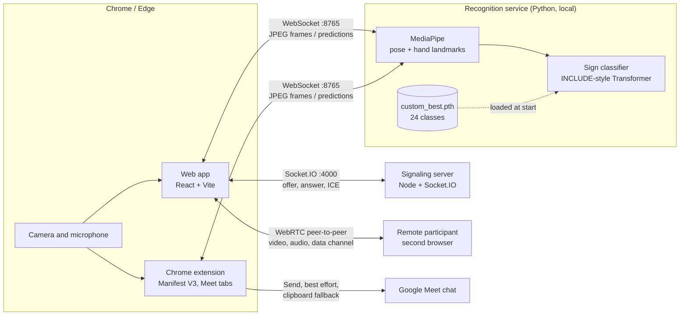
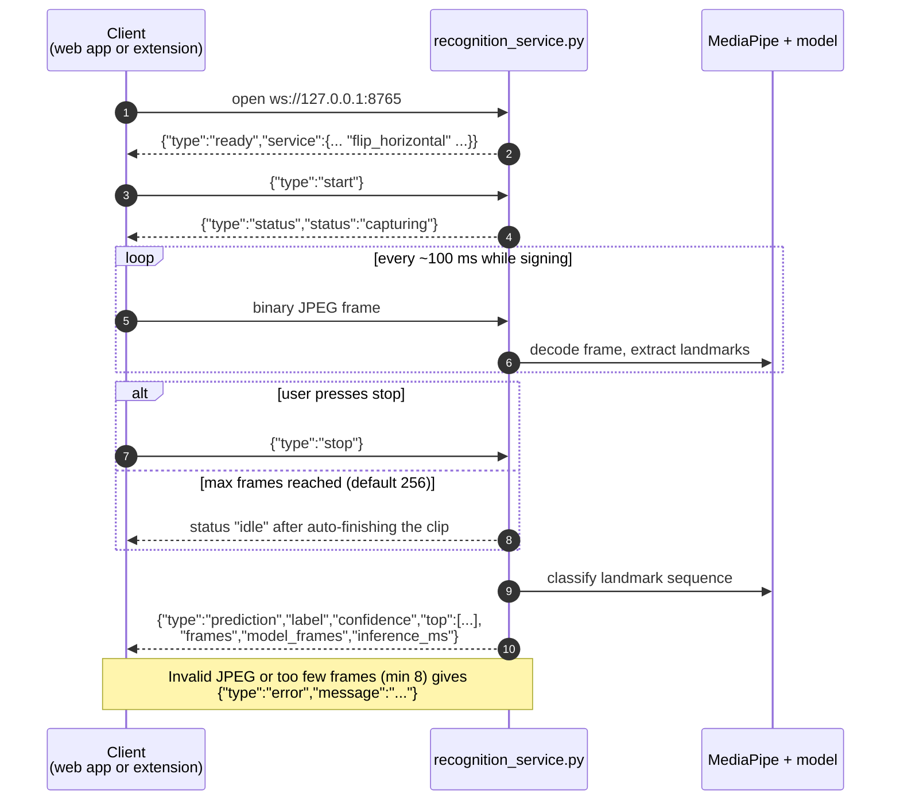
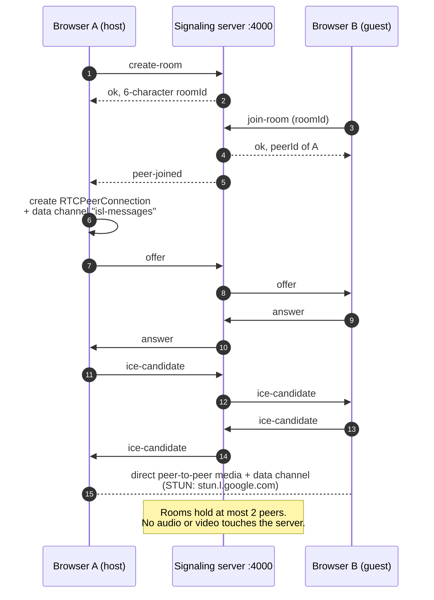
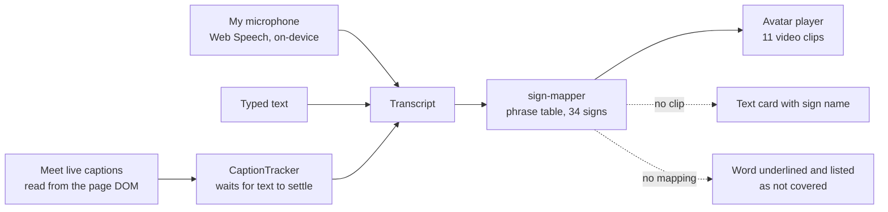

# Samvaad (ISL Connect) — System Architecture

Architecture diagrams and notes for the Samvaad / ISL Connect repository. The diagrams are written in
[Mermaid](https://mermaid.js.org/), so they render directly on GitHub. Everything below was checked against the
code in this repo (file names are given so you can verify each claim).

## Contents

1. [Repository map](#1-repository-map)
2. [Runtime architecture](#2-runtime-architecture)
3. [Recognition WebSocket protocol](#3-recognition-websocket-protocol)
4. [Video call and signaling (web app)](#4-video-call-and-signaling-web-app)
5. [Speech → Sign direction](#5-speech--sign-direction)
6. [ML pipelines](#6-ml-pipelines)
7. [Ports, environment variables and startup order](#7-ports-environment-variables-and-startup-order)
8. [Known gaps and caveats](#8-known-gaps-and-caveats)

---

## 1. Repository map

| Folder | What it is |
|---|---|
| `isl-connect/include-ml/` | PyTorch recognition code. `recognition_service.py` is the live WebSocket service; `train_custom.py`, `extract_keypoints_custom.py` and friends build the checkpoint. |
| `isl-comp-updated/isl-comp/` | React + Vite + TypeScript web app (landing page, how-it-works, two-person Communication Room). |
| `isl-comp-updated/isl-comp/server/` | Small Node + Socket.IO signaling server for WebRTC. |
| `chrome-extension/` | Manifest V3 extension for Google Meet (Sign → Text and Speech → Sign). |
| `isl-connect/recognition-ml/` | Separate TensorFlow/Keras experiment: personal data recording and signer-holdout fine-tuning. |
| `isl-connect/nlp-sentence-model/` | FastAPI service that turns a gloss list into a sentence (`POST /convert`). |
| `isl-connect/speech-pipeline/`, `avatar/`, `frontend/` | Earlier module skeletons from the original contracts (`isl-connect/docs/`). |

---

## 2. Runtime architecture

Two clients (the web app and the Chrome extension) use the **same** local Python recognition service.
Both send camera frames to it and get a predicted sign back.



**How the pieces connect**

- **Web app → recognition service.** `src/services/recognition.ts` opens a WebSocket to
  `VITE_RECOGNITION_SERVICE_URL` (default `ws://127.0.0.1:8765`), sends `{"type":"start"}`, then one JPEG per
  100 ms, then `{"type":"stop"}`, and waits for a `prediction` message.
- **Extension → recognition service.** `src/lib/recognition-client.js` speaks the same protocol. The panel runs in an
  extension iframe, so Meet's page CSP cannot block the camera or the WebSocket.
- **Extension → Meet.** Reviewed text is placed in Meet's chat box and sent only when the user presses **Send**.
  If the chat box can't be found, the text goes to the clipboard instead (`src/content/platforms/meet.js`).
- **Signaling server** only introduces the two browsers. Audio and video never pass through it.

---

## 3. Recognition WebSocket protocol

`recognition_service.py` handles one clip at a time per connection: start, stream frames, stop (or auto-finish), get a prediction.



Notes:

- The client drops frames (rather than queueing them) when the socket's send buffer is backed up
  (`recognition.ts` uses a 1 MB limit; the extension client has `maxBufferedBytes`).
- `flip_horizontal` in the `ready` message tells the client whether to mirror frames to match how the checkpoint was
  trained. The extension needs this because the service does not mirror frames itself.
- Service flags: `--host`, `--port` (8765), `--model`, `--labels`, `--device auto|cpu|cuda`, `--min-frames` (8),
  `--max-frames` (256).
- The service refuses to start unless the checkpoint is the **24-class, 134-feature** custom model.

---

## 4. Video call and signaling (web app)

The Communication Room uses a real two-person WebRTC call. The signaling server (`server/server.js`) is a relay
for room membership and connection setup, and nothing else.



- Room codes use an alphabet without `0/O/1/I` to avoid confusion.
- Only Google STUN servers are configured (`ICE_CONFIG` in `useVideoCall.ts`). There is no TURN server, so calls
  across strict NATs may fail. The code comment notes a TURN server can be added in that one place.
- The `isl-messages` data channel carries the translated messages between the two participants.

---

## 5. Speech → Sign direction

Two implementations exist, with different maturity.

### Chrome extension (Meet)



- Config lives in `config/avatar-signs.json` (clips and phrase table) and `config/default-signs.json`.
- Captions are read from Meet's page, and the extension does not record meeting audio.
- Microphone mode runs on-device by default and does **not** fall back silently to cloud speech recognition.
- Only 11 signs currently have a clip: daughter, doctor, happy, hello, house, lawyer, parent, sad, student,
  train station, waiter. The other mapped signs show as text cards.
- Nothing is stored. The transcript lives in panel memory until the panel closes.

### Web app

`useSpeechRecognition.ts` (browser Web Speech API) feeds `utils/phraseMapper.ts`, which maps words and phrases to sign
IDs. The web app README states the 3D avatar is still **mocked** behind a swappable interface.

---

## 6. ML pipelines

There are **two separate ML pipelines** in this repo. Only the first one is loaded by the live service.

```mermaid
flowchart TB
  subgraph A["A. include-ml: serves live recognition (PyTorch)"]
    direction LR
    A1["Raw clips"] --> A2["extract_keypoints_custom.py<br/>MediaPipe landmarks"]
    A2 --> A3["make_splits_custom.py"]
    A3 --> A4["train_custom.py<br/>INCLUDE Transformer"]
    A4 --> A5[("custom_best.pth")]
    A5 --> A6["recognition_service.py<br/>live WebSocket service"]
    A5 --> A7["evaluate_custom.py<br/>live_inference.py"]
  end

  subgraph B["B. recognition-ml: personalization experiment (TensorFlow/Keras)"]
    direction LR
    B1["sign_reference.html<br/>24 reference videos"] --> B2["record_personal_data.py<br/>--signer NAME"]
    B2 --> B3["data/personal_raw/"]
    B3 --> B4["extract_personal_features.py"]
    B4 --> B5["data/personal_features/<br/>100 x 225 per clip"]
    B5 --> B6["finetune.py<br/>--base-model, --holdout-signer"]
    B6 --> B7[("fine-tuned Keras model")]
    B7 --> B8["Signer-holdout evaluation"]
  end
```



| | A. `include-ml` | B. `recognition-ml` |
|---|---|---|
| Framework | PyTorch | TensorFlow / Keras |
| Model | INCLUDE-style Transformer (`custom_model.py`, built on Hugging Face `transformers`) | LSTM 128 → LSTM 64 (`src/model.py`) |
| Input features | 134 per frame: 25 pose points × 2 + 21 points × 2 coordinates × 2 hands | 100 frames × 225 values |
| Output | `models/custom_scratch/custom_best.pth` (24 classes) | Keras model saved separately from the base model |
| Used by live app | **Yes**, loaded by `recognition_service.py` | **Not by the service as written** |

**The 24 classes:** Beautiful, Bird, Daughter, Doctor, Dog, Father, Hello, House, I, Lawyer, Mother, Parent,
Restaurant, Son, Student, Teacher, Thank you, Train Station, Waiter, happy, he, sad, she, you.

**Fine-tuning workflow (pipeline B)**

1. Each teammate watches `sign_references/sign_reference.html`, then records 8–10 clips per sign with
   `python src/record_personal_data.py --signer NAME` (keys: `n` next, `p` previous, `r` start/stop, `q` quit).
2. Each person zips their own `data/personal_raw/<NAME>/` folder and sends it to the project owner.
3. The owner runs `python src/extract_personal_features.py` to produce `data/personal_features/`.
4. `python src/finetune.py --holdout-signer NAME` fine-tunes the base model (defaults: 20 epochs, batch 8,
   learning rate 1e-4, patience 6; `--freeze-base-layers` is optional).
5. The held-out signer is excluded from training so the result shows how well the model generalizes to someone new.

Never commit `data/raw_selected/`, `data/features_selected/`, `data/personal_raw/`, `data/personal_features/`
or `include_selected/`.

**Original module contracts** (`isl-connect/docs/CONTRACTS.md`): recognition emits
`{gloss, confidence, timestamp}`; `nlp-sentence-model` exposes `POST /convert` taking `{"signs": [...]}` and returning
`{"text", "lang"}` (FastAPI, port 8000 in its docstring); phrase mapping returns a gloss list; the avatar exposes
`playSigns([...])`. Gloss IDs are `SCREAMING_SNAKE_CASE`.

---

## 7. Ports, environment variables and startup order

| Service | Where | Address |
|---|---|---|
| Recognition service | `isl-connect/include-ml` | `ws://127.0.0.1:8765` |
| Signaling server | `isl-comp-updated/isl-comp/server` | `http://localhost:4000` (`PORT` overrides) |
| Web app (Vite dev server) | `isl-comp-updated/isl-comp` | `http://localhost:5173` (usually) |
| NLP sentence API (optional) | `isl-connect/nlp-sentence-model` | `http://localhost:8000` |

`.env.local` in the web app folder:

```
VITE_SIGNALING_SERVER_URL=http://localhost:4000
VITE_RECOGNITION_SERVICE_URL=ws://127.0.0.1:8765
```

**Start in this order, each in its own terminal**

1. Recognition service: `cd isl-connect/include-ml`, activate the Python 3.12 venv, `python recognition_service.py`
2. Signaling server: `cd isl-comp-updated/isl-comp/server && npm install && npm start`
3. Web app: `cd isl-comp-updated/isl-comp && npm install && npm run dev`
4. Extension: `chrome://extensions` → Developer mode → **Load unpacked** → select `chrome-extension/` (the folder with
   `manifest.json`). Reload it after pulling updates.

Use Chrome or Edge, since the Web Speech API is Chromium-only.

---

## 8. Known gaps and caveats

- **Checkpoint is not in Git.** `custom_best.pth` is git-ignored. Get the approved file from the project owner.
- **Pin two dependencies:** `pip install "mediapipe==0.10.14" "transformers==4.44.2"`. Newer `transformers` (5.x)
  breaks the model code, and newer MediaPipe releases removed `mp.solutions`.
- **Two ML pipelines.** The fine-tuned Keras model from `recognition-ml` is not loaded by `recognition_service.py`,
  which expects a PyTorch checkpoint with 134 features. Using personalized weights live would mean either porting
  the fine-tuning to the PyTorch pipeline or adding a Keras path to the service.
- **Test status** (from `chrome-extension/README.md`): unit tests, a fake-Meet browser test and a protocol check pass.
  Real Google Meet behavior (panel injection, chat posting, caption scraping) and real-checkpoint inference were
  not tested in that environment.
- **Avatar coverage is small:** 11 clips in the extension, and the web app avatar is mocked.
- **No TURN server**, so WebRTC calls may fail across restrictive networks.
- **Not traced:** whether the current web app calls the `nlp-sentence-model` API, or whether `isl-connect/frontend`
  is still in use. Both appear in the original contracts, but the web app's runtime path above uses the recognition
  service directly.